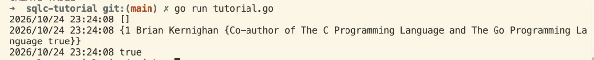

# sqlc Getting Started (PostgreSQL)

This repository contains the completed code from the official [sqlc Getting Started with PostgreSQL tutorial](https://docs.sqlc.dev/en/latest/tutorials/getting-started-postgresql.html). 

It demonstrates how to use `sqlc` to generate type-safe Go code directly from SQL schemas and queries.




## Try the Tutorial Yourself

If you want to build this from scratch, follow the excellent step-by-step guide here:
**[sqlc Getting Started Guide](https://docs.sqlc.dev/en/latest/tutorials/getting-started-postgresql.html)**

## Prerequisites

To run this project locally, you will need:
- [Go](https://go.dev/doc/install) (1.18 or later)
- [sqlc](https://docs.sqlc.dev/en/latest/reference/installation.html) installed locally
- A running PostgreSQL database (Docker, Rancher Desktop, or local install)

## Project Structure

- `sqlc.yaml`: The configuration file telling `sqlc` where to look and what to generate.
- `schema.sql`: Contains the database DDL (table creations).
- `query.sql`: Contains the actual SQL queries (CRUD operations) with `sqlc` annotations.
- `tutorial/`: The **auto-generated** Go package containing the type-safe database methods. *(Do not edit these files manually!)*
- `tutorial.go`: The main application code that connects to the database and uses the generated code.

## How to Run

1. **Start your PostgreSQL Database**
   Make sure you have a PostgreSQL instance running locally. If you're using Rancher Desktop:
   ```bash
   nerdctl run --name sqlc-tutorial-postgres -e POSTGRES_PASSWORD=mysecretpassword -p 5432:5432 -d postgres
   ```
   *(Note: Make sure the connection string in `tutorial.go` matches your database credentials and port!)*

2. **Generate the Go Code**
   Whenever you make changes to `schema.sql` or `query.sql`, regenerate the Go code:
   ```bash
   sqlc generate
   ```

3. **Install Dependencies**
   ```bash
   go mod tidy
   ```

4. **Run the App**
   ```bash
   go run tutorial.go
   ```